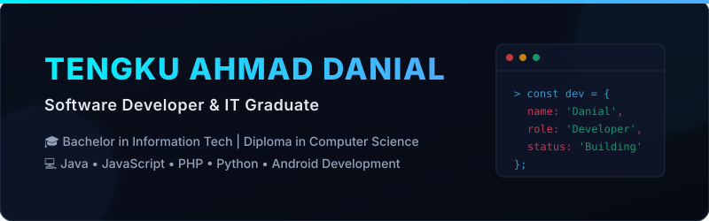

# Welcome to my GitHub Profile! ⚡

  

  
  

---

## ⚡ About Me

Hello! 👋 I'm Danny, an Information Technology student from Malaysia with an interest in web and software development, including UI/UX, graphic and multimedia design.

I'm currently pursuing my **Bachelor of Information Technology** at **Universiti Teknologi MARA (UiTM)** and previously completed a **Diploma in Computer Science**.

I enjoy developing full-stack web applications, designing user interfaces, working with databases, and turning project ideas into functional systems. I'm always open to discussing web development projects, collaborating on open-source repositories, and exploring career opportunities.

- 🎓 **Education:** Bachelor of Information Technology (In Progress) & Diploma in Computer Science
- 💼 **Focus:** Full-stack Web Development & Software Applications
- 🎨 **Other Interests:** UI/UX, Graphic & Multimedia Design
- 📍 **Location:** Malaysia (UTC/GMT+08:00)

---

## 🛠️ Tech Stack & Skills

<table align="center">
  <tr>
    <td valign="top" width="50%">
      <h3>🌐 Web Development</h3>
      
      
      
      
      
    </td>
    <td valign="top" width="50%">
      <h3>☕ Programming & Mobile</h3>
      
      
      
      
    </td>
  </tr>
  <tr>
    <td valign="top" width="50%">
      <h3>🗄️ Database & Development Tools</h3>
      
      
      
      
      
    </td>
    <td valign="top" width="50%">
      <h3>💻 Environments & Platforms</h3>
      
      
      
      
    </td>
  </tr>
</table>

---

## 📂 Featured Projects

Here are some of the key projects I have developed using different technologies and development approaches:

### 🕌 [TutorMeQuran - Quran Tutor Booking Web Application](https://github.com/KuDanial/tutormequran-web-application-php)

> **A full-stack web application for finding and booking Quran tutors in Malaysia.**

- **Overview:** A centralized platform that connects students with qualified Quran tutors for physical and online classes.
- **Key Features:** Role-based Student, Tutor and Admin accounts, tutor verification, tutor availability, booking and rescheduling, lesson coordination, cancellation and completion, DuitNow payment receipt verification, booking-linked chat, notifications, tutor feedback, support requests, FAQ management, rule-based FAQ chatbot, and Admin reports with CSV export.
- **Security & Validation:** Session-based authentication, RBAC, CSRF protection, protected file uploads, server-side validation, prepared SQL statements, output escaping, and controlled access to private files.
- **Database:** 23-table relational database with booking, payment, communication, verification and support workflows.
- **Testing:** Extensive automated integration testing covering the application's major modules and cross-module workflows.
- **Tech Stack:** `PHP 8`, `MariaDB`, `MySQL/PDO`, `JavaScript`, `HTML5`, `CSS3`, `Python Testing`, `XAMPP`.

### 🎫 [DIZA Event Tickets (Java Servlet & JSP)](https://github.com/KuDanial/DIZA-Event-Ticket-Servlet)

> **A ticket booking and event logistics management platform developed using Java web technologies.**

- **Architecture:** Model-View-Controller (MVC) with Java Servlets, JSP pages and database integration.
- **Key Features:** User booking system, ticket validation, ticket status checking, and backend Admin dashboard for organizers.
- **Tech Stack:** `Java`, `Jakarta Servlets`, `JSP`, `Tomcat`, `HTML5`, `CSS3`.

### 🚗 [Campus Ride Booking System - GrabWeb UiTM](https://github.com/KuDanial/Campus-Ride-Booking-System)

> **A web prototype developed for managing fixed-route campus shuttle rides.**

- **Key Features:** Shuttle route tracking, user profiles, booking history dashboard, and administrative console.
- **Tech Stack:** `PHP`, `JavaScript`, `MySQL`, `HTML5`, `CSS3`, `Responsive Grid Layout`.

### 🪙 [zGold Danny Calculator (Android App)](https://github.com/KuDanial/zgold-danny-calculator)

> **An Android application designed to calculate gold Zakat payments based on standard Shariah rules in Malaysia.**

- **Key Features:** Visual calculation progress, gold type selection (keep vs. wear), and dynamic rate updates.
- **Tech Stack:** `Java`, `Android SDK`, `XML Layouts`, `Shariah Rules Computation`.

### 🎮 [NoxPass Subscription Platform (Front-end Web App)](https://github.com/KuDanial/noxpass-ecommerce-platform)

> **A high-fidelity responsive front-end interface for a digital PC game subscription service.**

- **Key Features:** Fluid animations, interactive game explorer, pricing and plan selectors, and interactive UI components.
- **Tech Stack:** `HTML5`, `CSS3 (Vanilla)`, `JavaScript (ES6+)`, `Flexbox/Grid`.

---

## 📈 GitHub Stats

  
  

  

---

## ✉️ Let's Connect!

- **LinkedIn:** [linkedin.com/in/tengkuahmaddanial](https://www.linkedin.com/in/tengkuahmaddanial/)
- **Email:** tengkuahmaddanial420@gmail.com

---

  ❤️ Thank you for visiting! ❤️

